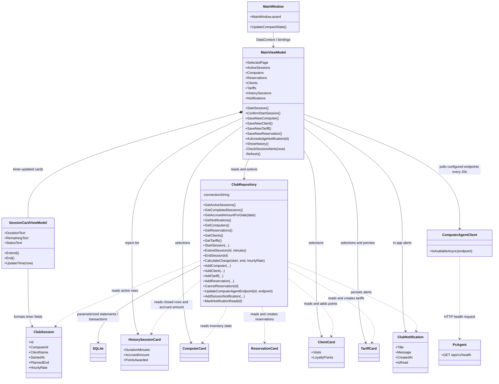

# Діаграма класів LEOPARD

`ClubRepository` owns transactional rules and SQLite access. ViewModels format view state and dispatch commands; Views contain AXAML bindings rather than SQL or domain mutation.

