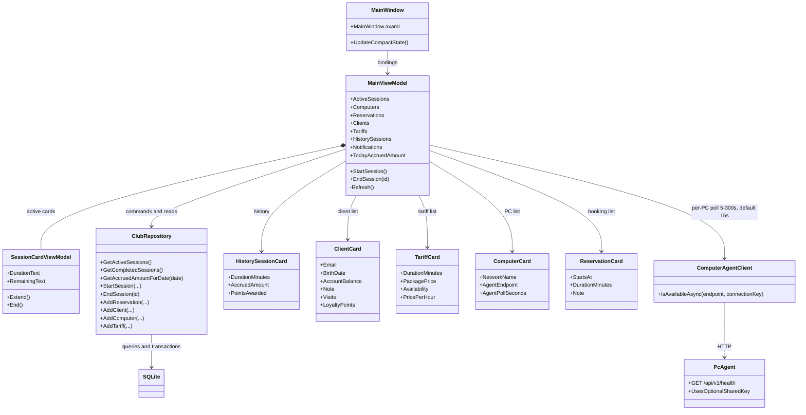

# LEOPARD — повна документація

Цей файл є головною документацією LEOPARD: тут зібрані запуск, інструкція адміністратора, вимоги, архітектура, дизайн, розрахунок суми, PC Agent і межі реалізації.

## 1. Призначення та можливості

LEOPARD — настільна програма адміністратора комп’ютерного клубу на C#, .NET 10, Avalonia UI та MVVM. Вона веде локальний облік комп’ютерів, клієнтів, тарифів, сеансів і бронювань.

Реалізовано:

- картки ПК із зоною, мережевим ім’ям і характеристиками CPU, GPU, RAM, монітора й накопичувача;
- профілі клієнтів з ім’ям, телефоном, email, датою народження, початковим балансом і приміткою;
- тарифи з тривалістю пакета, ціною за пакет, доступністю та погодинним еквівалентом;
- початок, продовження й завершення сеансів;
- живі таймери, пошук і фільтри активних сеансів;
- бронювання з перевіркою часових перетинів;
- історію завершених сеансів і денну суму нарахувань;
- внутрішні сповіщення про час сеансу;
- бонусний бал за кожну повну годину завершеного сеансу;
- окремий PC Agent для перевірки доступності вузлів у локальній мережі;
- компактний режим інтерфейсу для вузького вікна.
- Редагування ПК, клієнтів і тарифів; архівування та відновлення без фізичного видалення записів.
- Архівація блокується для ПК або клієнта з активним сеансом чи майбутнім бронюванням, а для тарифу — з активним сеансом.
- Погодинна ставка фіксується під час старту сеансу, тож зміна тарифу не переписує нарахування.

Нова база порожня: адміністратор вводить власні дані клубу.

## 2. Запуск і розгортання у Windows

### Запуск із вихідного коду

Потрібні Windows 10/11, Git, .NET 10 SDK та доступ до NuGet для першого відновлення пакетів. Репозиторій публічний, GitHub-акаунт для клонування не потрібен.

У **CMD**:

```cmd
git clone https://github.com/stanislavslobodyan/leopard-club-management.git
cd /d leopard-club-management
dotnet --version
dotnet restore LEOPARD.slnx
dotnet run --project src\LEOPARD\LEOPARD.csproj
```

Якщо репозиторій уже є на диску, відкрий CMD у його корені й виконай останню команду. Збірка без запуску:

```cmd
dotnet build LEOPARD.slnx -c Release
```

### Запуск програми на другому ПК без .NET

На ПК розробки з .NET 10 SDK створи автономну збірку Windows x64:

```cmd
dotnet publish src\LEOPARD\LEOPARD.csproj -c Release -r win-x64 --self-contained true -o publish\LEOPARD
```

Скопіюй **усю** папку `publish\LEOPARD` на другий ПК, наприклад у `C:\LEOPARD`. Там не потрібно встановлювати .NET або Avalonia. Запусти `LEOPARD.exe`:

```cmd
cd /d C:\LEOPARD
LEOPARD.exe
```

Не копіюй лише `.exe`: застосунку потрібні сусідні файли з цієї папки. Для оновлення створи нову збірку й заміни файли програми, не видаляючи базу даних на цільовому ПК.

### Розгортання PC Agent

Для клубних ПК, де потрібна лише перевірка зв’язку, окремо опублікуй агент:

```cmd
dotnet publish src\LEOPARD.PcAgent\LEOPARD.PcAgent.csproj -c Release -r win-x64 --self-contained true -o publish\PC-Agent
```

Перенеси всю папку `publish\PC-Agent` на вузол і запусти `LEOPARD.PcAgent.exe`. Після цього в LEOPARD для відповідної картки ПК задай адресу `http://IP-АДРЕСА:47831`. Для автоматичного запуску після перезавантаження Windows потрібно окремо налаштувати Планувальник завдань або службу.

### Зберігання та перенесення даних

SQLite обрано як просте локальне сховище, яке не потребує окремого сервера для одного адміністративного ПК. База зберігається в `%LOCALAPPDATA%\LEOPARD\club.sqlite3` під профілем користувача Windows. На різних комп’ютерах це окремі бази; мережевої синхронізації немає. Для одночасної роботи з кількох станцій знадобляться серверна БД та API.

Для резервної копії закрий LEOPARD і скопіюй `club.sqlite3`. Для перенесення на інший ПК запусти там програму один раз, закрий її й заміни створений файл бази копією з попереднього ПК. Не копіюй базу під час роботи програми. Старий файл `leopard.db`, якщо він існує, автоматично не видаляється й не імпортується.

## 3. Посібник адміністратора

### Початкове налаштування

1. У розділі **Комп’ютери** додай робочі місця, зони та їхні характеристики.
2. У розділі **Тарифи** створи тариф: назву, тривалість, ціну пакета та доступність. LEOPARD покаже погодинний еквівалент.
3. У розділі **Клієнти** додай ім’я й телефон; email, дату народження, початковий баланс і примітку можна заповнити додатково.
4. За потреби створи бронювання на майбутній час.

### Редагування й архівація записів

У розділах **Робочі місця**, **Клієнти** та **Тарифи** відкрий запис кнопкою з олівцем, зміни поля й збережи. Кнопка архіву прибирає запис з активного списку, але залишає його та суміжні сеанси у SQLite. Перемикач архіву показує кількість записів і дає змогу повернути їх у роботу. Фізичного видалення для цих записів немає.

Не можна архівувати ПК або клієнта з активним сеансом чи майбутнім бронюванням. Тариф не архівується, поки ним користується активний сеанс. Сеанс зберігає погодинну ставку, зафіксовану під час старту; редагування тарифу впливає на нові сеанси.

### Почати сеанс

1. Натисни **Почати сеанс**.
2. Вибери доступний ПК, клієнта, тариф і планову тривалість. Гра автоматично береться з улюбленої гри клієнта або зі значення за замовчуванням.
3. Перевір характеристики вибраного ПК та попередній розрахунок вартості.
4. Підтверди старт. Якщо ПК конфліктує з бронюванням, сеанс не розпочнеться.

Картка сеансу показує клієнта, гру, тариф, час початку, фактичну тривалість і час до планового завершення. Подовження додає 30 хвилин.

### Завершити сеанс

Натисни **Завершити** на картці. LEOPARD фіксує час завершення та суму за тарифом, оновлює денний підсумок і історію, звільняє ПК, додає клієнту візит і бонусні бали. Статусне повідомлення показує суму, нараховану за сеанс.

### Короткий сценарій перевірки

Додай ПК, клієнта й тариф **60 хв за 120 ₴**. Почни 15-хвилинний сеанс, зачекай близько 30 секунд і заверши його. Очікуване нарахування — близько **1,00 ₴** у повідомленні, історії та денному підсумку. Фактичне значення залежить від секунд і округлення до копійок.

### Бронювання, історія та сповіщення

- Бронювання містить ПК, клієнта, дату, час початку й завершення, тривалість і необов’язкову примітку. Його можна змінити або скасувати. Перетини з іншим бронюванням чи активним сеансом відхиляються.
- Історія показує до 300 останніх завершених сеансів із тривалістю, сумою та бонусними балами.
- Денний підсумок охоплює всі завершення за поточну локальну дату, а не тільки записи, які показані в останніх 300 рядках історії.
- Внутрішні сповіщення з’являються за 15 хвилин до планового кінця та після спливу часу.
- Бонус — один бал за кожну повну годину. Бали не є грошима й не обмінюються на гривні автоматично.

## 4. Облік суми та оплати

Під час завершення сума розраховується за **фактичним часом** між початком сеансу й натисканням **Завершити**:

```text
нарахування = тариф за годину × фактична тривалість у секундах ÷ 3600
```

Сума округлюється до двох знаків після коми правилом `MidpointRounding.AwayFromZero`. Наприклад, тариф 120 ₴/год і 30 хвилин фактичного часу дають 60,00 ₴. Подовження сеансу враховується, бо тарифується фактичний час.

Для тарифу-пакета погодинний еквівалент дорівнює ціні пакета, помноженій на 60 і поділеній на тривалість пакета у хвилинах. Саме цей еквівалент використовується для фактичного нарахування за сеанс. Погодинна ставка копіюється в запис сеансу під час його старту. Подальше редагування або архівування тарифу не змінює нарахування активного чи завершеного сеансу. Під час завершення сума записується в SQLite. Для давніх сеансів міграція заповнює нову колонку ставкою тарифу; сума без окремого збереженого значення обчислюється з часу та зафіксованої ставки. Для раніше збережених сеансів без поля суми вона обчислюється з наявних часу та тарифу після безпечного додавання колонки до схеми БД.

**Це внутрішнє нарахування, а не факт оплати.** LEOPARD наразі:

- не приймає оплату та не підключена до каси, банку, термінала або платіжного провайдера;
- не фіксує метод платежу чи отримання готівки;
- не списує гривні з клієнта й не веде журналу операцій чи грошового гаманця; початковий баланс у профілі клієнта зберігається лише як поле обліку;
- не створює фіскальний чек або бухгалтерську проводку.

Для реального платіжного обліку знадобиться окремий журнал платежів із сумою, часом, методом, статусом, адміністратором і посиланням на сеанс. Не можна вважати оплату здійсненою лише тому, що сеанс завершився.

## 5. Вимоги

### Функціональні

| ID | Вимога | Реалізація |
|---|---|---|
| FR-01 | Вести інвентар ПК | Додавання й редагування характеристик; архів і відновлення без видалення суміжних записів |
| FR-02 | Вести клієнтів | Профіль, редагування даних і архівування; візити й бали зберігаються |
| FR-03 | Вести тарифи | Додавання/редагування, архів і відновлення; зміна тарифу не змінює чинні сеанси |
| FR-04 | Починати сеанс | Вибір ПК, клієнта, тарифу й планової тривалості; гра підставляється з профілю клієнта |
| FR-05 | Керувати активним сеансом | Таймер, пошук/фільтри, подовження на 30 хв, завершення |
| FR-06 | Бронювати ПК | Майбутні слоти, примітка, редагування, скасування та перевірка перетинів |
| FR-07 | Вести історію та денну суму | Збережене нарахування за фактичним часом і тарифом |
| FR-08 | Нараховувати лояльність | 1 бал за кожну повну годину завершеного сеансу |
| FR-09 | Сповіщати про час | Поріг 15 хвилин та сплив планового часу |
| FR-10 | Перевіряти доступність ПК | Опційний PC Agent, online/offline стан |
| FR-11 | Приймати та фіксувати оплату | Не реалізовано |
| FR-12 | Віддалено керувати ігровими ПК | Не реалізовано; агент лише відповідає на health-запит |

### Нефункціональні

| ID | Вимога | Реалізація / обмеження |
|---|---|---|
| NFR-01 | Платформа | Windows 10/11, .NET 10 |
| NFR-02 | Локальне зберігання | SQLite у `%LOCALAPPDATA%\LEOPARD\club.sqlite3` |
| NFR-03 | Безпечне оновлення схеми | Нові nullable/defaulted колонки (`IsArchived`, `HourlyRateSnapshot` тощо) додаються при запуску; наявні записи зберігаються |
| NFR-04 | Розділення відповідальностей | Avalonia AXAML Views, MVVM ViewModels, services/repository |
| NFR-05 | Вузьке вікно | Компактний layout за ширини менше 760 px; Android target не налаштований |
| NFR-06 | Безпека PC Agent | HTTP у довіреній приватній LAN; необов’язковий спільний ключ не шифрує трафік |
| NFR-07 | Багатокористувацька синхронізація | Не реалізована; SQLite локальна для профілю/ПК |
| NFR-08 | Тестування | Збірка .NET та ручний сценарій; автоматизованого test project немає |

## 6. Архітектура та технології

### MVC та MVVM

У **MVC** Model містить дані й правила, View показує результат, а Controller приймає дії/запити та координує відповідь. Така схема поширена у вебзастосунках з HTTP-маршрутами.

У **MVVM** View прив’язаний через bindings до властивостей і команд ViewModel. ViewModel тримає стан екрана й делегує предметні операції сервісам. Це відповідає Avalonia та XAML, де зміни властивостей оновлюють інтерфейс.

LEOPARD використовує **MVVM**: `ClubRepository` містить запити SQLite та транзакції, ViewModels керують взаємодією й станом екрана, AXAML описує подання. View не містить SQL.

### Порівняння UI-фреймворків

| Фреймворк | Переваги | Відповідність LEOPARD |
|---|---|---|
| Avalonia UI | C#/XAML, desktop Windows/Linux/macOS, переносимий UI-код | Обрано для .NET desktop і спільного адаптивного інтерфейсу |
| WPF | Зрілий XAML і глибока інтеграція з Windows | Підійшов би для Windows-only; менше переносимості |
| WinUI 3 | Сучасний нативний інтерфейс Windows | Підходить для Windows; не дає спільного Android target |
| .NET MAUI | C#/XAML та mobile/desktop targets | Кращий кандидат, якщо першочергово потрібен Android/iOS; його workloads у цьому проєкті не налаштовані |

### Technologies

| Розділ | Технології |
|---|---|
| BackEnd | C#, .NET 10, Microsoft.Data.Sqlite, SQLite, окремий console PC Agent |
| FrontEnd | Avalonia UI, AXAML, CommunityToolkit.Mvvm, Inter |
| Testing | `dotnet build`, ручний сценарій; автоматизованих тестів наразі немає |
| Design | Темна LEOPARD адмінпанель, кіберспортивні акценти, адаптивні картки; [референс у Figma](https://www.figma.com/design/II7p117iCRAZJgZPMJDQub/LEOPARD-%E2%80%94-%D0%A1%D0%B8%D1%81%D1%82%D0%B5%D0%BC%D0%B0-%D0%BA%D0%B5%D1%80%D1%83%D0%B2%D0%B0%D0%BD%D0%BD%D1%8F-%D0%BA%D0%BB%D1%83%D0%B1%D0%BE%D0%BC?node-id=0-1) |

### Діаграма класів



## 7. Інтерфейс і дизайн

Інтерфейс звірено з [макетом LEOPARD у Figma](https://www.figma.com/design/II7p117iCRAZJgZPMJDQub/LEOPARD-%E2%80%94-%D0%A1%D0%B8%D1%81%D1%82%D0%B5%D0%BC%D0%B0-%D0%BA%D0%B5%D1%80%D1%83%D0%B2%D0%B0%D0%BD%D0%BD%D1%8F-%D0%BA%D0%BB%D1%83%D0%B1%D0%BE%D0%BC?node-id=0-1). Нижче описано його реалізацію в застосунку.

- Тло `#0B0E13`, навігація `#10141B`, картки `#151A22`, обводка `#242B36`.
- Основний текст `#F2F4F7`, другорядний `#929BA8`, акцент `#C7F36B`, бронювання `#72B8FF`, попередження `#FFB454`.
- Шрифт Inter. Картки мають радіус близько 12 px і відступи 14–18 px.
- Desktop має ліву навігацію 232 px, заголовок розділу, дату, основну дію та картки показників. Дубльовані підписи про SQLite й локальну мережу прибрано знизу; там показуються повідомлення про виконані дії.
- **Огляд** показує активні сеанси, вільні/заброньовані ПК, загальну кількість комп’ютерів, нарахування й майбутнє бронювання.
- **Активні сеанси** показують ПК, клієнта, гру, тариф, час початку, тривалість, залишок часу й дії продовження/завершення.
- **Бронювання** має денний розклад і список слотів; можна перемикати дату, створити, змінити чи скасувати слот.
- **Робочі місця** показують зону, статус і характеристики; картки підтримують редагування, архівування та відновлення. Архів недоступний, якщо є активний сеанс чи майбутнє бронювання.
- **Клієнти** мають пошук, показники відвідувань і балансу, редагування й архів із відновленням; клієнта з активним сеансом чи майбутнім бронюванням архівувати не можна.
- **Тарифи** показують тривалість, ціну, доступність і погодинний еквівалент; підтримують редагування, архів та відновлення. Тариф не архівується, доки є активний сеанс.
- **Історія** показує завершені сеанси, тривалість, нарахування та бонусні бали.
- Форми сеансу, клієнта, бронювання, ПК, тарифу та PC Agent мають спільні темні поля, підказки, валідацію й акцентні дії; у картках і списках є швидкі кнопки редагування та архіву.
- За ширини менше 760 px бічна панель ховається, контент переходить у компактну навігацію й адаптивні картки.
- Базовий desktop-кадр — 1360 × 900 px; мінімальний описаний макет — 360 × 620 px.
- Це компактний desktop layout; окремий Android APK/target не налаштований.

## 8. PC Agent: API та мережеві межі

На кожному клубному ПК агент треба запускати окремо. LEOPARD опитує налаштовані адреси з інтервалом, який задається окремо для кожного ПК (від 5 до 300 секунд; стандартно 15 секунд), із таймаутом запиту 3 секунди. Статус доступності агента окремий від облікового стану ПК.

Для додаткового обмеження запитів до агента можна задати змінну середовища `LEOPARD_AGENT_KEY` на клубному ПК. Той самий ключ потрібно зберегти в налаштуваннях агента для цього ПК у LEOPARD. Агент відхиляє запити без відповідного заголовка `X-Leopard-Agent-Key`. Якщо змінну середовища не задано, endpoint стану доступний у локальній мережі без ключа.

У CMD запусти агент із ключем так (підстав однаковий ключ на агентному ПК і в налаштуваннях агента у LEOPARD):

```cmd
set "LEOPARD_AGENT_KEY=<спільний-ключ>"
LEOPARD.PcAgent.exe
```

Поле «Сервер клубу» зберігається в конфігурації ПК, але поточна версія агента використовує лише health-запит до адреси та порту ПК.

Agent слухає TCP `47831` (порт можна змінити аргументом) і підтримує лише:

| Метод | Endpoint | Результат |
|---|---|---|
| GET | `/api/v1/health` | JSON з ідентифікатором вузла, версією агента, UTC-часом і `health: ready` |

```json
{
  "agentId": "CLUB-PC-01",
  "agentVersion": "1.0.0.0",
  "observedAt": "2026-11-05T12:30:00+00:00",
  "health": "ready"
}
```

Для локальної перевірки запусти агента та в LEOPARD задай `http://127.0.0.1:47831`. Для іншого ПК укажи його адресу в LAN. На агентному ПК Windows Firewall має обмежити TCP `47831` приватною локальною мережею й, бажано, IP адміністративної станції.

Агент використовує HTTP. За замовчуванням він доступний без ключа; за потреби ввімкни `LEOPARD_AGENT_KEY` і обмеж доступ до порту через Windows Firewall. Спільний ключ зберігається у локальній SQLite без шифрування й надсилається HTTP-заголовком без шифрування. Використовуй агент лише у довіреній LAN і не відкривай порт в інтернет. Агент не блокує екран, не керує живленням, не запускає/закриває ігри, не читає CPU/GPU/RAM і не приймає оплату.

## 9. Відомі обмеження

- Локальна SQLite база не синхронізується між адміністративними ПК; немає серверного API чи облікових записів користувачів.
- Сума — нарахування за тарифом, не отриманий платіж; немає каси, еквайрингу, фіскалізації чи грошового гаманця.
- Початковий баланс у профілі клієнта не є журналом грошей: програма не списує й не поповнює його під час сеансів.
- Характеристики комп’ютера вводяться адміністратором; Agent їх автоматично не зчитує.
- PC Agent працює тільки після окремого розгортання і налаштування адреси на кожному вузлі.
- Agent використовує HTTP і необов’язковий ключ, який не шифрується при зберіганні чи передачі. Його можна використовувати лише в довіреній приватній LAN.
- Історія показує останні 300 сеансів; денний підсумок рахується окремим запитом по всіх завершеннях за локальну дату.
- Немає окремого Android застосунку; компактний режим показується у вузькому desktop-вікні.
- Автоматизованого test project наразі немає; для ручної перевірки використовуй короткий сценарій у розділі 3.

## 10. Ідеї для наступної версії (ще не реалізовані)

- **Картка клієнта з таймлайном**: історія сеансів, улюблені ігри та дата наступного візиту в одній бічній панелі.
- **Теплова мапа завантаженості**: години й дні тижня, коли зал найчастіше зайнятий, щоб планувати акції та зміни.
- **Резервні копії бази з інтерфейсу**: створення копії й відновлення з перевіркою дати та розміру файлу.
- **Контроль бронювань**: позначки запізнення й неявки та статистика бронювань, що перейшли у сеанс.
